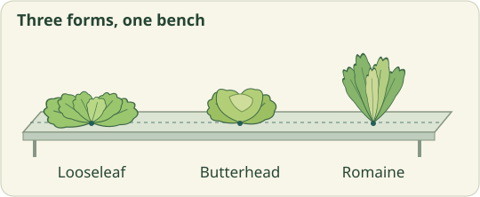
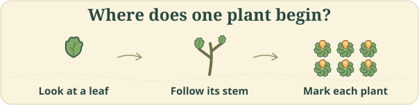
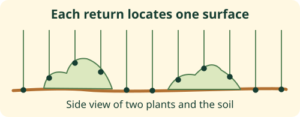

# Greenhouse bench lettuce

Try to find a planting hole when neighboring heads touch. A scanner looking straight down often sees a leaf where the hole ought to be. The generator knows the hole’s position and can score a prediction against it.

## Read the plant and its support

Look down a real greenhouse channel in figure 10. The white channel tops and edges show through near the viewer. Farther along, leaves cover more of the support. In the opening photograph, the heart of each head sits inside a ring of larger leaves. A test should include both exposed support and substantial leaf cover. [Alabama Extension greenhouse photographs](https://www.aces.edu/blog/topics/crop-production/greenhouse-lettuce-production/)

Here the bench is a simplified continuous support above a level floor. In v3 the base of each stem meets the 73 cm support, including the plants at the ends of a row. All three market types grow from one short stem per planting. **Looseleaf** spreads broad, ruffled blades outward. **Butterhead** folds rounder inner leaves over the heart. **Romaine** carries longer upright blades. A cultivar, spacing and harvest stage can change the appearance within any of these types. The sketch compares shapes at one base height, without a calibrated size scale. [Illinois Extension, types of lettuce](https://extension.illinois.edu/gardening/lettuce) · [Rosette generator](lettuce.js)

## Try an occlusion test

1. Choose **Greenhouse bench lettuce** with structured plants in the Field Generator. Pick a fixed form and seed. Generate a healthy scan with farm hardware visible.
2. Change only plant condition to damaged and generate the field again. The damage rule removes or shortens outer blades on one side. Notice where the underlying bench becomes visible and whether the highest leaf moves sideways. This is geometric damage without a diagnosis or modeled cause.
3. Compare the two scans from above, then from the side in the viewer. Rotating the view preserves exactly the same returns. Record how many planting bases a detector matches within your chosen tolerance, alongside the number of extra pins on exposed support.

The planting target is one position per lettuce. A long bright-looking support surface in the viewer belongs to the greenhouse infrastructure. [Open the Field Generator](https://mvalancy.github.io/crop-trainer/?crop=bench-lettuce&plantArchitecture=3) · [Plant architecture guide](../../docs/crop-architecture.md)

On three clean synthetic plantings at 30,000 requested rays, upright romaine averaged 6.8 crop returns per plant, compared with 10.8 for looseleaf. The fitted detector scored about 0.745 F1 at 15 cm on both. A decline in raw returns alone did not predict worse detection on these benches. Replay with `node benchmark/studies/plant-forms.mjs bench-lettuce`. [Experiment design and scores](../../docs/crop-form-benchmark.md) · [Paired benchmark code](../../benchmark/studies/plant-forms.mjs)
