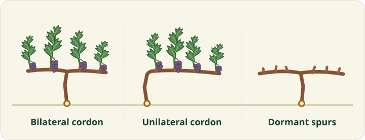

# Trellised grapevine

Follow a vine from the soil to the wire. Its upright trunk bends into a permanent horizontal arm called a **cordon**. Short woody stubs called **spurs** carry the new shoots. In a summer row the shoots of neighboring vines can overlap. A detector gets one planting target at the foot of each trunk, even when several plants look like one continuous strip of leaves. [Open a fruiting vineyard](https://mvalancy.github.io/crop-trainer/?crop=grapevine&plantArchitecture=2&plantForm=bilateral-cordon&plantCondition=healthy&sensor=reference&seed=27#field)

## Grow the three forms

| Form in the recipe | What grows from one trunk |
| --- | --- |
| `bilateral-cordon` | Two arms extend in opposite directions. Each has three or four spur sites with upright shoots. |
| `unilateral-cordon` | One longer arm runs along the row. Five to seven spur sites place most leaves on one side of the base. |
| `pruned-cordon` | A dormant bilateral vine retains its trunk, both arms and short spurs. The woody silhouette is the whole plant. |

1. Anchor the trunk at the labeled planting position. Bend it in two tapered segments to the cordon level, 0.82–1.00 m above local soil in this model.
2. Build the arms and place the spurs first. This lets the dormant and leafy bilateral forms share the same woody framework when sampled with the same plant seed.
3. For a fruiting vine, grow four to six leaf nodes per shoot. A short stalk joins each broad blade to an alternating side of the shoot. Some lower shoots carry a hanging group of berries. Plant vigor changes shoot height, and leaf size and tilt vary. [Generator code](grapevine.js)

## Read the photographs

Texas A&M’s photograph shows how vertical shoot positioning produces a narrow leaf wall above a clear trunk. Plate 56 from a Queensland pruning trial shows a trunk turning into one long horizontal arm, with short spurs along its upper edge. Georgia’s before-and-after pruning photographs show the short spurs left on permanent wood. The simulation borrows these arrangements. Arm lengths, the number of berries and the amount of variation are modeling choices. [Texas A&M, figure 2](https://aggie-horticulture.tamu.edu/wp-content/uploads/sites/13/2020/05/Grapevine-Trellis-Systems-for-Winegrapes-in-Texas-EHT121.pdf#page=2) · [Queensland Agricultural Journal, plate 56](https://era.dpi.qld.gov.au/id/eprint/14418/1/Vol_71NS_Part_2_RECHECK.pdf#page=33) · [UGA Extension, figure 6](https://fieldreport.caes.uga.edu/publications/B1505/dormant-spur-and-cane-pruning-bunch-grapevines/)

## Try a broken arm

The damaged condition shortens one arm partway between two spur sites. A stump and the nearer spurs remain. Leaves, shoots and fruit beyond the break disappear. A unilateral vine can still be alive and labeled after losing most of its visible canopy. Compare the same seed in both conditions, then switch to a sparser scan to see which organs still receive a return. [Healthy unilateral row](https://mvalancy.github.io/crop-trainer/?crop=grapevine&plantArchitecture=2&plantForm=unilateral-cordon&plantCondition=healthy&sensor=reference&seed=27#field) · [Broken unilateral row](https://mvalancy.github.io/crop-trainer/?crop=grapevine&plantArchitecture=2&plantForm=unilateral-cordon&plantCondition=damaged&sensor=reference&seed=27#field)

An overhead ray stops at the uppermost surface. Leaves can hide fruit and trunks, and a bare cordon may fall between sample locations. The structure overlay exposes generated geometry for inspection. Only the XYZ returns are available to the detector. A field survey would be needed to measure real planting-location accuracy.

In a three-field synthetic test with the same 68 vine bases and 30,000 overhead rays per field, bilateral vines averaged 100 crop returns per plant. Dormant vines averaged 12. The fitted detector scored F1 of 0.216 and 0.244 respectively at a 15 cm matching distance. The extra leaf returns offered little help finding the trunks in this test. [Reproduce the crop-form benchmark](../../docs/crop-form-benchmark.md)
