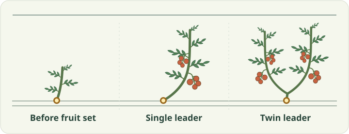

# Greenhouse high-wire tomato

A **leader** is a growing main stem. In a greenhouse, a grower can guide one or two leaders from one plant toward an overhead support. A **truss** is a branching stalk bearing several flowers or fruit. Look for the shared planting base when the foliage splits into two tops. The trainer awards one planting target to that plant. [Open the twin-leader greenhouse](https://mvalancy.github.io/crop-trainer/?crop=high-wire-tomato&plantArchitecture=2&plantForm=twin-leader&plantCondition=healthy&sensor=reference&seed=27#field)

## Grow the three forms

| Form in the recipe | Structure to look for |
| --- | --- |
| `young-leader` | A short, lightly leaning stem has compound leaves close to its base. This stage precedes fruit set. |
| `single-leader` | One fruiting stem leans down the row and turns upright near its tip. The older lower stem has a bare section. |
| `twin-leader` | A short common stem forks near the substrate. Two fruiting stems fan out along the row and carry their own leaves and trusses. |

1. Place the stem base 0.20 m above the simulated greenhouse floor at trough height. The wire and trough belong to the greenhouse fixture layer.
2. Choose plant vigor and draw the leader in tapered segments. The young leader has five to seven nodes. Each mature leader has nine to eleven. Seeded differences in height, lean and leaf reach vary the row’s profile.
3. At each retained leaf node, bend the leaf stalk outward. Attach two pairs of side leaflets and a terminal leaflet. On mature plants, selected lower nodes also carry a descending truss with three to five individually attached fruit. [Generator code](high-wire-tomato.js)

## Read the photographs

Alberta’s propagation photographs show small leafy plants before transplanting and the later row growing up twine. Ontario’s production guide shows two stems leaving the same rootstock, and Alabama Extension shows how a mature single stem is held and pruned. A real greenhouse camera frame shows a hanging truss next to distinct leaflets. The generator uses those relationships. The precise height, internode spacing and fruit sizes are synthetic. [Alberta, figures 6 and 8](https://www.alberta.ca/tomato-plant-propagation-in-commercial-greenhouse-tomato-production) · [Ontario, figures 3 and 4](https://www.publications.gov.on.ca/store/20170501121/Free_Download_Files/302001.pdf#page=12) · [Alabama Extension, figures 2 and 3](https://www.aces.edu/wp-content/uploads/2023/02/ANR-2955_GreenhouseTomatoProduction_022223L-G.pdf#page=4) · [Burusa greenhouse photograph](https://github.com/akshaykburusa/tomato_greenhouse_dataset/blob/main/images/1000-60-120_color.jpg)

## Try a missing growing tip

The damaged condition breaks one leader between two nodes, leaving lower stem and foliage attached. On a twin-leader plant the second stem keeps growing to its usual height. Switch between healthy and damaged fields at the same seed and compare the structure overlay with the overhead returns. [Healthy single leader](https://mvalancy.github.io/crop-trainer/?crop=high-wire-tomato&plantArchitecture=2&plantForm=single-leader&plantCondition=healthy&sensor=reference&seed=27#field) · [Broken single leader](https://mvalancy.github.io/crop-trainer/?crop=high-wire-tomato&plantArchitecture=2&plantForm=single-leader&plantCondition=damaged&sensor=reference&seed=27#field)

The overhead scanner records the first visible surface. A leaf can hide an entire fruit or a stem junction. The highest return can lie well along the row from the planting base. This makes the three forms a test of localization across crop stages and training systems. Fruit yield, ripeness and a grower’s pruning schedule would require separate measurements.

Across three synthetic fields with the same 192 plant bases and 30,000 rays per field, twin leaders averaged 45.7 crop returns per planting and single leaders averaged 25.9. Their F1 scores at 15 cm were nearly identical, 0.360 for twins and 0.365 for singles. A second head gave the scanner more surfaces while leaving the number of required base detections fixed. [Reproduce the crop-form benchmark](../../docs/crop-form-benchmark.md)
