# Where is the center of a lettuce?

A loose-leaf lettuce spreads across the bed. A butterhead packs broad leaves into a tighter head. Romaine sends longer blades upward. In NC State’s photographs, compare the frilly margins of ‘Ashbrook’ with the closer overlapping leaves of the heading types. The greenhouse lettuce in Cornell’s photograph sits above the support surface, with roots underneath. These photographs guided the shapes drawn by the generator. [NC State lettuce gallery](https://plants.ces.ncsu.edu/plants/lactuca-sativa/) · [Cornell greenhouse photograph](https://cals.cornell.edu/school-integrative-plant-science/degrees-programs/integrative-plant-science-mps-degree/controlled-environment-agriculture-cea-concentration)

## How a head grows in the simulator

Start at the short stem and rotate around it as each new leaf appears. The outer leaves reach farthest. The inner leaves start higher and occupy the heart. Each blade has an arched center line, a width that tapers toward the ends and a margin that curls up. A seed varies the count, reach and angle. The field and bench presets can grow the same three forms. The bench places the stem 74 cm above the greenhouse floor. [Lettuce generator](lettuce.js) · [Surface sampler](surfaces.js)

| Choose this form | Look for this in the scan |
| --- | --- |
| Loose-leaf rosette | A low, wide canopy with separated, ruffled outer blades. |
| Cupped butterhead | More overlapping blades. Some inner tips curl back toward the stem. |
| Upright romaine | Fewer, narrower and taller blades, clustered near the center when viewed from above. |

The scanner samples the highest visible surface at each ray. A tall, tight heart and a wide rosette can produce different patterns of peaks even at the same ray budget. The field lettuce label uses the center of the canopy’s bounding box. The bench label uses the planting position, even when leaves lean away from it.

## Take one head apart

Open both scans, highlight a plant and choose **Focus plant**. On the damaged form a sector of outer leaves is missing and adjacent blades are shorter. Watch how the visible outline changes and which leaves still produce the tallest returns. Both links use the same crop, form, sensor, seed and clean scan settings. [Healthy romaine](https://mvalancy.github.io/crop-trainer/?crop=lettuce&plantArchitecture=2&plantForm=romaine&plantCondition=healthy&seed=31907&sensor=reference&noise=clean&box=3#field) · [Damaged romaine](https://mvalancy.github.io/crop-trainer/?crop=lettuce&plantArchitecture=2&plantForm=romaine&plantCondition=damaged&seed=31907&sensor=reference&noise=clean&box=3#field)

These are procedural canopy sketches. The blade dimensions, spiral and damage pattern are choices for testing. Measuring the spread, leaf inclination and head height of a named cultivar at a specific age would let you calibrate a closer model. The canopy scan leaves fine veins, below-bench roots and internal head layers unresolved.
