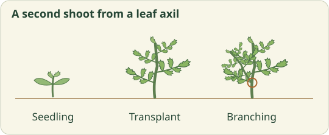
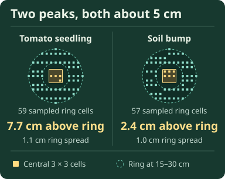

# Young tomato

A young tomato is already a small branching structure. Look at the seedling photo first. Two narrow seed leaves, called cotyledons, sit below the first true leaves. A true tomato leaf has multiple leaflets attached to a shared stalk. Each leaflet can create a separate patch of LiDAR returns. [NC State Extension seedling and leaf photographs](https://plants.ces.ncsu.edu/plants/solanum-lycopersicum/)

## Three vegetative forms

| Form | What to look for |
| --- | --- |
| **Seedling** | A small main shoot, two long seed leaves and a few early true leaves. Sparse sampling can miss the whole plant between rays. |
| **Transplant** | More compound leaves along one main shoot. Several high points can sit on one spreading leaf or on different leaves from the same stem. |
| **Branching** | A side shoot leaves the main stem at a leaf axil. Its own leaves can shift the highest point to one side. The plant still has one base. |

The axil is where a leaf joins the stem. In a real tomato this is where a side shoot, often called a sucker, can develop. The depicted forms are snapshots of vegetative plants. They carry no fruit and specify no calendar age. The separate high-wire tomato selection represents greenhouse training and pruning. [New Hampshire Extension, pruning tomato plants](https://extension.unh.edu/resource/pruning-tomato-plants-fact-sheet) · [Young tomato generator](young-tomato.js) · [High-wire tomato](high-wire-tomato.md)

## Try a missed-plant test

Choose **Young tomato** with structured plants, a fixed dataset seed and a fixed form. Compare a dense and a sparse scan of the same planting. Check the number of returns on each labeled plant. When a plant has returns, inspect whether they form a candidate peak, and whether that candidate survives scoring. This distinguishes a small plant that the scanner missed from one the model scored too low.

Next restore the original scan layout and change only the condition to damaged. The synthetic injury snaps the main shoot and omits leaves attached above the break. A lower surviving leaflet can now be the tallest surface. For young tomato, the scored target is the horizontal midpoint of the whole plant’s bounding box. Removing upper leaves can shift this reference as well as the detector’s pin. Compare each pin to the label for its own variant. [Open the Field Generator](https://mvalancy.github.io/crop-trainer/?crop=tomato&plantArchitecture=3) · [Inspect detections](../../docs/field-inspection.md)

In a three-planting synthetic replay at 30,000 requested rays, seedlings averaged about one crop return per plant. Only 2% of targets had a candidate peak within 15 cm, and the fitted detector matched none there. The same weights reached 0.508 F1 on transplants and 0.834 on branching plants at that tolerance. Extra fitting cannot place pins where the candidate detector found no peak. Replay with `node benchmark/studies/plant-forms.mjs tomato`. [Experiment design and scores](../../docs/crop-form-benchmark.md) · [Paired benchmark code](../../benchmark/studies/plant-forms.mjs)

See how many seedlings produced a laser return, a height peak and a correctly placed pin on six plots. The guide includes an interactive replay of one field at 30,000 and one million rays. [Seedling density experiment](../../docs/seedling-density.md)

## Can you spot the soil bump?

These patches come from a healthy seedling field with soil present. One peak lands near plant 8. The other is over 38 cm from the nearest plant. Each square in the center or ring marks a 5 cm cell with at least one return. How much a peak rises above its neighbors helps distinguish this pair. Read the experiment to see how many seedlings still go undetected across whole fields. [Open the pictured ring scan](https://mvalancy.github.io/crop-trainer/?crop=tomato&plantArchitecture=2&plantForm=seedling&plantCondition=healthy&sensor=os1-64&seed=1370561&budget=60000&ground=true&weeds=off&sticks=off&boards=off&noise=clean&tile=cb233b1e0e3f65f8) · [Try both feature sets](../../docs/tomato-local-ground.md)
