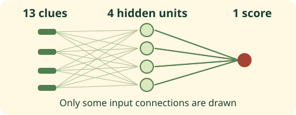

# Inside the live training view

Open **Design the model** in the Training Shed and add a hidden layer. The diagram updates before training begins. After a run, **Explore learned weights** shows the incoming weights and bias for any unit. [Open the Training Shed](https://mvalancy.github.io/crop-trainer/trainer/)

| To change | Open |
| --- | --- |
| The layer editor, model diagram, duration display or weight inspector | [Training sandbox](sandbox.js) |
| Following a signal through the selected network | [Network diagram](network-diagram.js) and [diagram styles](network-diagram.css) |
| Sizing and grouping training settings | [Training layout](training-layout.css) |
| Showing which plant forms supplied training examples, with and without ground | [Example counts and bars](sampling-receipt.js) |
| Inspecting a measured training loss at a saved epoch | [Training loss curve](loss-curve.js) |
| Live scan points and predicted pins during generation and training | [Live scene](live-scene.js) |
| Entering and leaving an expanded viewer | [Fullscreen controls](fullscreen.js) |

The [training page controller](../main.js) connects those controls to the [model code](../models/README.md). The [field viewer](../../app/viewer.js) supports orbiting and inspecting the generated plot.
